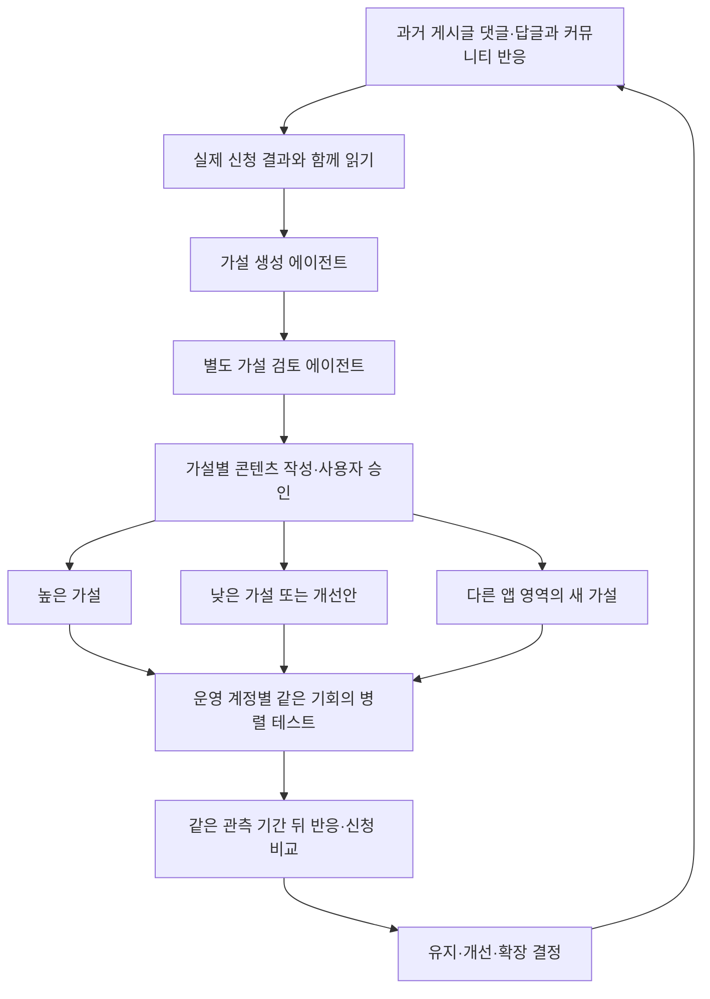

# Mu — 사용자 반응으로 다음 가설을 만드는 GTM 루프

> **반응을 읽고 가설을 만든다. 높은 쪽과 낮은 쪽을 병렬로 다시 시험한다. 결과를 확인하고 새로운 앱 작업으로 확장한다.**

Clone Loop Day · 2026-10-24 · 첫 채널 Threads

## 1. 제품과 목표

Mu는 카카오톡으로 부탁하면 모바일 앱을 직접 조작해 일을 처리하는 개인 비서다. 현재는 사전 사용 신청 단계다.

첫 고객 가설은 인기 식당을 예약하려고 앱에서 날짜·시간·인원을 반복 확인하는 사람이다. “이번 토요일 저녁, 두 명 예약 가능한지 확인해줘”라는 상황에서 시작한다. 이후 배송 조회·장바구니·메일 요약 등으로 실험을 넓힌다. 음식 예약은 첫 사용 사례이며 제품 전체 범위를 제한하지 않는다.

**최종 지표는 7일 동안 이번 캠페인에 귀속되는 중복 없는 신규 사전 신청자 수다.** 댓글·좋아요·클릭은 신청 완료와 구분한다. 예약 성공·좌석 선점·즉시 이용은 약속하지 않는다.

## 2. 전체 루프

처음에는 높은·낮은 결과가 없으므로 가설을 균등하게 시험한다. 자료가 생기면 높은 쪽과 낮은 쪽을 함께 다시 확인한다. 낮은 가설도 즉시 버리지 않고 댓글에서 원인을 찾아 개선한다.

## 3. 무엇을 수집하고 어떻게 판단하는가

| 단계 | 입력·할 일 | 판단 기준 |
| --- | --- | --- |
| 반응 수집 | 이전 게시글 전체의 댓글·답글, 관련 커뮤니티 대화 | 원문·시각·맥락·누락 확인. 중복·팀·스팸 분리 |
| 가설 생성 | 사용자 경험·관심·거절·질문과 신청 결과 | 어떤 고객이 어떤 이유로 신청할 것인가? 무엇이 나오면 틀렸다고 볼 것인가? |
| 독립 검토 | 가설·근거·예상·반증 조건 | 실제 근거가 있는가? 신청 지표로 확인 가능한가? 계정·시점 차이를 고려했는가? |
| 병렬 테스트 | 높은·낮은·새 가설의 콘텐츠 | 같은 게시 기회·관측 기간, 운영 계정 교차 배치, 사용자 승인 |
| 결과 확인 | 반응 변화와 실제 신규 신청 | 충분히 관측했는가? 높은·낮은·동률·미확인 중 무엇인가? |
| 다음 실험 | 결과와 반대 근거 | 높은 쪽 재현, 낮은 쪽 개선, 다른 작업 확장 중 무엇을 시험할 것인가? |

자기 게시물 반응과 외부 커뮤니티 대화는 별도로 기록한다. 커뮤니티에서 관심이 보였다고 우리 캠페인의 신청으로 세지 않는다. 같은 사람의 반복 댓글은 여러 고객의 요구가 아니다.

## 4. 복잡한 최적화 대신 같은 조건의 비교

| 비교 슬롯 | 목적 | 예시 |
| --- | --- | --- |
| 높은 쪽 | 좋은 반응이 다시 나오는지 확인 | 배송 확인을 맡기려는 의사와 실제 신청이 관측됨 |
| 낮은 쪽 / 개선안 | 낮은 이유를 확인하고 한 조건 수정 | 예약 확인을 예약 성공 보장으로 오해해 설명 수정 |
| 새 영역 | 기존 가설 밖의 가능성 탐색 | 아침마다 메일을 요약해 달라는 작업 |

예시는 설명용이며 실제 고객 성과가 아니다.

슬롯마다 같은 수의 게시 기회를 주고 같은 기간을 기다린다. 초기 설정은 최대 3개 슬롯, 계정별 하루 1회, 관측 24시간이다. 여러 계정에 가설을 교차 배치해 특정 계정의 독자를 가설 자체의 성과로 오해하지 않도록 한다.

실제 계정은 현재 `@mu.agent` 하나다. 운영 권한·게시 연결이 확인된 계정만 사용한다. 계정이 1~2개라면 슬롯을 순환하며 완전한 동시 비교라고 표시하지 않는다.

**톰슨 샘플링이나 확률 배분은 사용하지 않는다.** 반응과 숫자를 나란히 보고 다음 실험을 정하는 단순한 구조다.

## 5. 높은 수치와 낮은 수치의 기준

최종 비교는 검증된 신규 신청을 기준으로 한다. 같은 관측 기간의 배포당 신청 수를 계정 조건별로 확인한다. 초기에는 계정·시간 조건별 최소 2회의 완료 관측을 요구한다. 이 수치는 운영용 가정이며 통계적 유의성 기준이 아니다.

반응 지표는 원인 판단에 쓴다.

- **댓글 호응 높음 + 신청 낮음:** 신청 과정·설명·신뢰 문제를 확인한다.
- **댓글 적음 + 신청 높음:** 댓글 수만 보고 낮은 가설로 버리지 않는다.
- **오해·신청 마찰 반복:** 해당 문제를 고친 후보를 만들어 비교한다.
- **도달 부족·수집 실패·아직 관측 중:** 낮은 성과로 확정하지 않는다.
- **동률·표본 부족:** 추가 관측한다. 승자를 억지로 만들지 않는다.

캠페인 전체 신청만 알 수 있으면 가설별 성과를 비교할 수 없다. 실제 신청까지 가설·배포 식별이 이어져야 한다. 같은 사람을 서로 다른 가설의 성과로 중복 집계하지 않는다. 현재 실제 귀속 연결은 준비 전이다.

## 6. 에이전트별 Rubric을 교체할 수 있다

| 에이전트 | 평가 기준 |
| --- | --- |
| 가설 생성 | 반응 근거, 검증 가능성, 기존 가설과 다른 검증 축 |
| 가설 검토 | 증거 품질, 신청 지표 연결, 비교 조건의 타당성 |
| 콘텐츠 작성 | 가설 유지, 제품 주장 근거, 신청 안내·귀속 |
| 결과 검토 | 관측 완료, 반대 근거·혼동 요인, 다음 실험의 타당성 |

기준은 코드에 고정하지 않고 역할별 JSON 파일로 둔다. 기준을 바꾸면 그 버전으로 다시 평가한다. 어떤 가설을 어떤 기준과 근거로 통과시켰는지 기록한다. 가설 생성자가 자신의 가설을 최종 승인하지 않는다.

Rubric은 에이전트의 판단 품질을 검토한다. **Rubric 점수는 실제 사용자 반응이나 신청 성과를 대신하지 않는다.**

## 7. 실험은 음식 예약에서 계속 넓어진다

초기에는 음식 예약·배송 조회·장바구니처럼 제품이 소개하는 작업을 가설로 만든다. 반응과 신청을 보고 높은 가설은 기준으로 남기고, 낮은 가설의 개선안과 다른 앱 작업을 새 후보로 만든다.

새 가설에는 부모·변경 이유·반응 근거를 연결한다. 기존 가설의 좋은 성과를 새 가설에 그대로 넘기지 않는다. 같은 결과로 같은 가설을 매번 생성하지 않는다. 초기 활성 가설은 최대 5개로 제한해 관리 가능한 범위를 유지한다.

## 8. 현재 어디까지 확인했는가

| 항목 | 현재 상태 |
| --- | --- |
| 반응 수집·판단 구조 | 과거 게시글·커뮤니티 구분, 누락·중복·병목 처리 구현 |
| 역할별 Rubric | 생성·검토·콘텐츠·결과 검토 4개 설정과 검증 계약 구현 |
| 병렬 실험 코어 | 높은·낮은·새 가설의 계정별 슬롯 계획, 관측 비교, 새 가설 요청 구현 |
| 테스트 | 단위·통합 **44개 통과** |
| 포트폴리오 Mock | 3가설·3합성 계정 → 7일 관측 → 높은·낮은 비교 → 개선안·메일 요약 확장 검증 |
| 실제 에이전트 모델·외부 연결 | 미연결. Mock 역할 평가와 합성 데이터로 검증 |
| 실제 게시·신청 | 미실행·미측정 |

Mock은 병렬 게시 **계획과 합성 영수증**을 검증한다. 실제 다계정 네트워크 게시나 실제 고객 전환 개선을 검증한 것은 아니다. 실제 게시 전 사용자 검토·명시 승인은 유지한다.

## 9. 발표 후 남은 일

1. 운영 계정과 이전 게시물·커뮤니티 수집을 연결한다.
2. 신청 접수·배포별 귀속·중복 제외·7일 측정 기간을 확정한다.
3. 실제 모델의 생성·검토와 배치 실행을 연결한다.
4. 최초 게시물을 사용자에게 검토받고 승인된 실험을 시작한다.

---

[상세 병렬 설계](docs/gtm/portfolio-loop.md) · [반응 Rubric](docs/gtm/rubric.md) · [역할·설정](config/portfolio.json) · [Mock 증거](runs/mock/PORTFOLIO-20261024T082539-545f71/report.md) · [전체 계획](PLAN.md)
