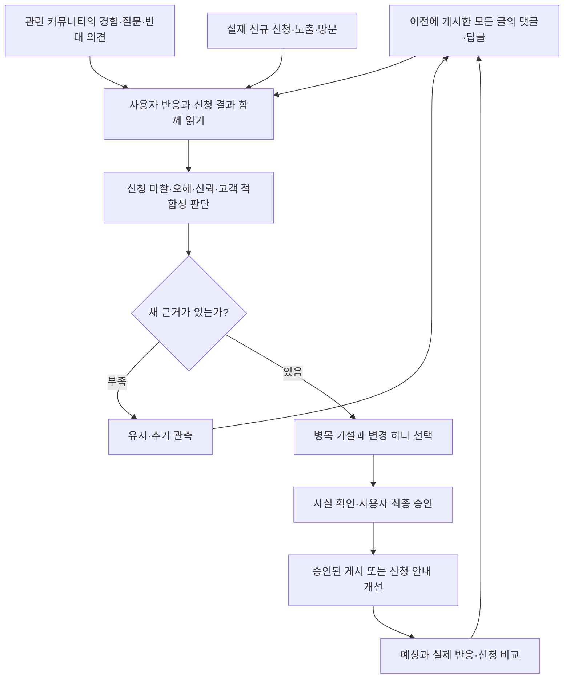

# Mu: 실제 신청을 보며 개선하는 GTM 루프

> 인기 식당 예약 확인이라는 구체적인 상황에서 시작해, 모바일 앱 작업을 메신저로 맡기는 Mu의 사전 사용 신청으로 연결한다.

2026-10-24 · Clone Loop Day · 첫 채널 Threads `@mu.agent`

**현재 상태:** 루프 설계와 로컬 판단 코어를 만들고 Mock 테스트로 검증했다. 실제 게시·신청 성과 측정·자동 실행 연결은 아직 시작하지 않았다.

## 1. 무엇을 누구에게 알리는가

Mu는 카카오톡으로 요청하면 모바일 앱을 직접 조작해 일을 처리하는 개인 비서다. 현재는 사전 사용 신청을 받는 단계다.

제품이 다루는 범위는 배송 조회·장바구니·예약 확인 등 다양한 앱 작업이다. 첫 홍보는 사람들이 바로 떠올릴 수 있는 상황 하나로 시작한다.

| 요소 | 첫 실험의 정의 |
| --- | --- |
| 고객 가설 | 인기 식당을 예약하려고 모바일 앱에서 날짜·시간·인원을 확인하는 사람 |
| 해결하려는 불편 | 앱을 열어 조건을 입력하고 가능한 시간을 확인하는 수고 |
| 대표 요청 | “이번 토요일 저녁, 두 명 예약 가능한지 확인해줘.” |
| 전달할 가치 | 직접 앱을 조작하던 일을 채팅으로 부탁하는 사용 방식 |
| 전환 행동 | Mu 사전 사용 신청 |
| 첫 채널 | Threads의 신규 계정 @mu.agent |

**좌석이 없는 문제와 앱에서 조회하는 번거로움은 다르다.** 첫 실험은 후자를 다룬다. 예약 성공·좌석 선점·즉시 이용을 약속하지 않는다. 모바일 앱 자동화의 가치를 설명하되 ‘예약은 모바일에서만 가능하다’고 단정하지 않는다.

공개 후기에서 반복 조회 행동은 관찰했지만, 이를 Mu에 맡기려는 의사와 실제 신청 의사는 아직 검증하지 못했다.

## 2. 무엇을 성과로 보는가

**주 지표: 7일 동안 이번 캠페인에 귀속되는 중복 없는 신규 사전 신청자 수.**

실제 접수가 확인된 신청만 센다. 기존 신청자·중복·내부 테스트·스팸은 제외하고 출처 불명 신청은 별도로 기록한다.

- 클릭·페이지 방문·메일 작성창 열기는 신청 완료가 아니다.
- 매일 누적 신청 수를 더하지 않는다. 캠페인 전체에서 같은 사람을 한 번만 센다.
- 아직 측정하지 못했다면 ‘미측정’이다. 신청 0명과 구분한다.
- 한 건의 신청도 관심 신호이지만 시장 검증이나 특정 문안의 효과를 확정하지 않는다.

실제 운영 전에는 7일 시작·종료 시각, 기존 신청자 기준, 접수와 유입 출처 확인 방법을 고정한다. 현재 이 준비는 미완료다.

## 3. 루프의 출발점은 이전 게시물의 사용자 반응이다

**이전 게시글 댓글·답글 + 관련 커뮤니티 반응 + 실제 신청 결과 → 신청을 막는 이유 → 변경 하나 → 다시 반응과 신청 확인.**

핵심 질문은 ‘글이 잘 쓰였나?’보다 **‘이 사용자들은 왜 신청하거나 신청하지 않는가?’**다. 문안 검토는 선택한 실험을 공개하기 전 보조 단계다.

## 4. 각 단계의 역할과 기준

| 단계 | 하는 일 | 판단 기준 | 결과 |
| --- | --- | --- | --- |
| ① 과거 게시 이력 읽기 | 캠페인 전체 게시 URL과 지난 가설 확인 | 최신 글뿐 아니라 이전 글도 관측 대상에 포함했는가? | 게시물·실험별 수집 목록 |
| ② 댓글·커뮤니티 수집 | 댓글과 답글, 관련 대화의 긍정·부정·질문 수집 | 원문·시각·맥락이 있는가? 페이지 누락·접근 실패가 있는가? | 반응·수집 범위·미수집 이유 |
| ③ 반응과 신청 연결 | 적격 작성자·불편·의사·실제 접수를 구분 | 같은 사람의 반복인가? 관심 발언인가 실제 신청인가? | 반응 분류·신청 증분·반대 근거 |
| ④ 병목 선택 | 전환을 방해할 수 있는 이유 판단 | 사용자 근거가 있고, 신청과 연결되는 설명인가? | 병목 가설·다른 설명·증거 |
| ⑤ 변경 하나 설계 | 설명·신청 과정·고객 상황 중 한 조건 변경 | 무엇이 달라지면 가설을 지지하거나 보류할 것인가? | 변경·고정 조건·예상·관측 기간 |
| ⑥ 검토·실행 | 사실 확인과 사용자 승인 후 실행 | 승인한 내용·계정·범위가 맞는가? | 승인·실제 게시 URL·시각 |
| ⑦ 효과 관측 | 같은 병목 반응과 실제 신청을 다시 확인 | 전후 기간·도달·수집·귀속 범위가 비교 가능한가? | 유지·추가 관측·수정·집계 점검 |

우리 게시물의 댓글은 그 게시물에 대한 반응이다. 외부 커뮤니티 대화는 고객 문제의 근거다. 둘을 합쳐 캠페인 성과라고 부르지 않는다. ‘좋아요’와 ‘신청했어요’라는 댓글도 실제 접수 확인 전에는 신청 수로 세지 않는다.

## 5. Rubric: 사용자는 어디에서 멈췄는가

Rubric은 아래 질문을 사용자 근거로 판단하는 기준이다. 각 항목을 **관측됨 / 반대 근거 있음 / 미확인**으로 기록하며, 문안 점수나 감성 점수를 합산하지 않는다.

| 판단 축 | 댓글·대화에서 찾는 근거 | 다음 행동 |
| --- | --- | --- |
| 문제 적합성 | 실제로 반복 조회가 번거롭다는 경험, 직접 하는 편이 낫다는 의견 | 고객 상황 유지 또는 재조사 |
| 위임 의사 | 맡기고 싶은 구체적 작업, 사용 조건, 맡기지 않는 이유 | 원하는 작업·조건 확인 |
| 이해 | 예약 성공 보장·즉시 이용으로 오해하는 반응 | 오해를 만든 설명 수정 |
| 신뢰 | 로그인·권한·결제를 이유로 주저하는 반응 | 확인된 근거로 권한·승인 설명 보완 |
| 신청 마찰 | 신청하려지만 링크·메일·절차에서 막힌 경험 | 재현 후 신청 과정 개선 |
| 전환 연결 | 실제 접수·유입 출처가 확인된 신규 신청 | 유지·후속 실험·판단 보류 |

병목 후보는 신청에 가까운 **신청 마찰 → 제품 오해 → 신뢰 우려 → 고객 상황 불일치** 순서로 검토한다. 이는 초기 우선순위이며 반대 근거도 함께 본다.

같은 글에서 서로 다른 적격 외부 작성자 2명 이상이 같은 병목을 말하면 실험 후보로 삼는다. 한 사람의 말은 맥락과 재현을 먼저 확인한다. ‘2명’은 운영 규칙이며 통계적 유의성 기준이 아니다. 반복 댓글·팀·스팸·미확인 작성자로 근거를 부풀리지 않는다.

## 6. 실제 반응이 어떻게 다음 변경으로 이어지는가

다음은 작동 검증을 위한 **합성 예시**다. 실제 고객 발언이나 성과가 아니다.

| 순서 | 관측·판단·행동 |
| --- | --- |
| 사용자 반응 | 서로 다른 두 사람이 ‘메일 신청 방법을 찾기 어렵다’고 반응 |
| 가설 | 관심이 있어도 신청 과정의 혼동 때문에 접수가 안 될 수 있음 |
| 다른 설명 | 제품 미출시·신뢰·도달 대상 차이도 신청에 영향을 줄 수 있음 |
| 변경 하나 | 신청 안내 문구 한 곳을 명확하게 수정 |
| 유지 | 채널·고객 가설·제품 제안 |
| 예상 | 같은 혼동 반응이 줄고 실제 신규 귀속 신청이 생기는지 확인 |
| 관측 | 다음 24시간 댓글·답글과 접수, 기간·도달·수집 범위 함께 기록 |
| 결정 | 비교 가능한 근거가 있으면 유지/후속 실험, 부족하면 보류 |

‘글이 더 명확해졌다’는 평가만으로 성공하지 않는다. **신청 마찰 반응과 실제 접수 결과**가 다음 판단을 바꿔야 한다.

한편 ‘예약 성공까지 보장하나요?’라는 오해가 반복되면 신청 안내보다 먼저 그 관측에 맞는 제품 설명을 실험할 수 있다. 커뮤니티에서 ‘직접 확인하는 편이 좋다’는 반대 의견이 나오면 삭제하지 않고 고객 가설을 검토하는 근거로 남긴다.

## 7. 어떤 경우에 유지·수정·보류하는가

| 상황 | 결정 |
| --- | --- |
| 댓글을 읽지 못했거나 일부 페이지만 수집 | 수집 보완. 무반응으로 해석하지 않음 |
| 같은 사람·같은 댓글을 다시 읽음 | 새 수요로 세지 않고 유지 |
| 새 적격 작성자의 동일 병목 반응 | 원인 확인 후 변경 하나 제안 |
| 커뮤니티에서만 문제·반대 의견 관측 | 고객 가설 조사. 우리 전환 효과는 미확인 |
| 댓글 호응은 늘었지만 실제 접수 미확인 | 전환 개선 판단 보류 |
| 같은 병목 반응 감소와 신규 신청 증가 | 개선과 일치하는 관측 기록; 인과 효과는 미확인 |
| 도달·기간·수집 범위가 다르거나 표본 부족 | 비교 한계를 기록하고 추가 관측 |
| 누적 신청 감소 | 제외·귀속 정정 근거 점검 |

이전 예상과 실제 관측을 비교하고 실패한 예측도 남긴다. 콘텐츠별 귀속이 안 되면 게시글별 승자를 선언하지 않는다. 매일 실행해도 새 근거가 없으면 매일 변경하지 않는다.

## 8. 구현과 검증 상태

반응 수집은 FeedbackAdapter라는 교체 가능한 연결부로 분리했다. 실제 원문을 조회하는 서비스 연결과, 받은 근거를 판단하는 코어를 구분한다.

| 항목 | 현재 상태 |
| --- | --- |
| 반응 수집 계약 | 모든 이전 게시물 댓글·답글, 커뮤니티, 누락·중복·익명 작성자 정의 |
| 반응 기반 판단 코어 | 병목 후보·반대 의견·신청 증분·과거 근거 보존 구현 |
| 다음 행동 | 콘텐츠 점수 대신 사용자 반응으로 결정 |
| 단위·통합 테스트 | 32개 통과 |
| 가상 7일 Mock | 합성 반응 5건으로 오해→설명 수정, 신청 마찰→안내 수정, 중복 재수집→유지 검증 |
| 콘텐츠 검토 | 사실·사전 사용 상태·승인을 확인하는 보조 단계 |
| 실제 댓글·커뮤니티 수집 연결 | 미연결. 기존 공개 조사를 신규 캠페인 반응으로 세지 않음 |
| 실제 게시 / 신규 귀속 신청 | 미실행 / 미측정 |
| 실제 자동 반복 | 런타임·스케줄러 미연결 |

실제 게시 URL이 아직 저장돼 있지 않아 캠페인 댓글을 수집한 상태는 아니다. Mock은 고정된 합성 반응으로 판단 코어를 검증하며, 실제 분류 정확도나 전환 개선을 검증하지 않는다.

## 9. 다음 실행

1. 게시 이력과 관측할 커뮤니티 URL을 수집 목록으로 만든다. 첫 게시 전에는 커뮤니티의 실제 경험과 반대 의견으로 초기 가설을 준비한다.
2. 반응 수집·실제 신청 집계를 연결하고 7일 관측 기간을 고정한다.
3. 사용자가 승인한 첫 게시 후 댓글·답글과 신청을 함께 관측한다.
4. 실제 병목을 근거로 변경 하나를 선택하고, 다음 관측에서 예측을 확인한다.

최초 한 번 수동으로 시작하고 이후 하루 한 번 반복하는 운영이다. 승인 대기 중에도 과거 게시물 관측을 계속한다. 실제 반복 등록이 확인돼야 자동 실행 중이라고 기록한다.

---

- [사용자 반응 Rubric](docs/gtm/rubric.md) · [댓글·커뮤니티 수집 계약](docs/gtm/reaction-collection.md)
- [전체 계획](PLAN.md)
- [반응 기반 7일 Mock 증거](runs/mock/DEMO-20261024T081424-142339/report.md)
- [보조 콘텐츠 검토](docs/gtm/content-checklist.md)
