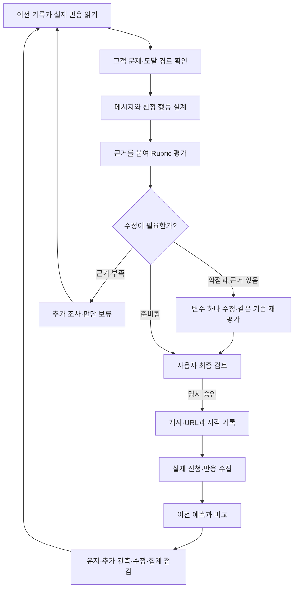

# Mu: 실제 신청을 보며 개선하는 GTM 루프

> 인기 식당 예약 확인이라는 구체적인 상황에서 시작해, 모바일 앱 작업을 메신저로 맡기는 Mu의 사전 사용 신청으로 연결한다.

2026-10-24 · Clone Loop Day · 첫 채널 Threads `@mu.agent`

**현재 상태:** 루프 설계와 로컬 판단 코어를 만들고 Mock 테스트로 검증했다. 실제 게시·신청 성과 측정·자동 실행 연결은 아직 시작하지 않았다.

## 1. 무엇을 누구에게 알리는가

Mu는 카카오톡으로 요청하면 모바일 앱을 직접 조작해 일을 처리하는 개인 비서다. 현재는 사전 사용 신청을 받는 단계다.

제품이 다루는 범위는 배송 조회·장바구니·예약 확인 등 다양한 앱 작업이다. 첫 홍보는 사람들이 바로 떠올릴 수 있는 상황 하나로 시작한다.

| 요소 | 첫 실험의 정의 |
| --- | --- |
| 고객 가설 | 인기 식당을 예약하려고 모바일 앱에서 날짜·시간·인원을 확인하는 사람 |
| 해결하려는 불편 | 앱을 열어 조건을 입력하고 가능한 시간을 확인하는 수고 |
| 대표 요청 | “이번 토요일 저녁, 두 명 예약 가능한지 확인해줘.” |
| 전달할 가치 | 직접 앱을 조작하던 일을 채팅으로 부탁하는 사용 방식 |
| 전환 행동 | Mu 사전 사용 신청 |
| 첫 채널 | Threads의 신규 계정 @mu.agent |

**좌석이 없는 문제와 앱에서 조회하는 번거로움은 다르다.** 첫 실험은 후자를 다룬다. 예약 성공·좌석 선점·즉시 이용을 약속하지 않는다. 모바일 앱 자동화의 가치를 설명하되 ‘예약은 모바일에서만 가능하다’고 단정하지 않는다.

공개 후기에서 반복 조회 행동은 관찰했지만, 이를 Mu에 맡기려는 의사와 실제 신청 의사는 아직 검증하지 못했다.

## 2. 무엇을 성과로 보는가

**주 지표: 7일 동안 이번 캠페인에 귀속되는 중복 없는 신규 사전 신청자 수.**

실제 접수가 확인된 신청만 센다. 기존 신청자·중복·내부 테스트·스팸은 제외하고 출처 불명 신청은 별도로 기록한다.

- 클릭·페이지 방문·메일 작성창 열기는 신청 완료가 아니다.
- 매일 누적 신청 수를 더하지 않는다. 캠페인 전체에서 같은 사람을 한 번만 센다.
- 아직 측정하지 못했다면 ‘미측정’이다. 신청 0명과 구분한다.
- 한 건의 신청도 관심 신호이지만 시장 검증이나 특정 문안의 효과를 확정하지 않는다.

실제 운영 전에는 7일 시작·종료 시각, 기존 신청자 기준, 접수와 유입 출처 확인 방법을 고정한다. 현재 이 준비는 미완료다.

## 3. 루프는 어떻게 돌아가는가

게시 전에는 문안의 약점을 다듬고, 게시 후에는 실제 반응으로 다음 판단을 교정한다.

승인 대기 중에도 이전 게시의 성과 수집과 분석은 계속한다. 매일 실행한다고 매일 새 글을 게시하거나 문안을 바꾸는 것은 아니다.

## 4. 각 단계에서 무엇을 하고, 무엇으로 판단하는가

| 단계 | 하는 일 | 판단 기준 | 남기는 결과 |
| --- | --- | --- | --- |
| ① 이전 기록 읽기 | 지난 가설·예상·관측·미확인 사항 확인 | 새 근거가 있는가? 지난 변경을 유지하거나 보류할 이유가 있는가? | 이번에 답할 질문과 선택 이유 |
| ② 고객·채널 조사 | 공개 원문과 도달 가능한 장소 확인 | 실제 앱 확인 불편이 표현됐는가? 접근·참여가 가능한가? 홍보 규칙에 맞는가? | 원문·시각·불편·적합성·선정 이유 |
| ③ 메시지 설계 | 식당 사례 → 범용 Mu → 사전 신청으로 연결 | 대상과 작업이 구체적인가? 맡길 가치와 현재 신청 단계가 분명한가? | 정확한 문안·신청 안내·게시 대상 |
| ④ 평가·수정 | 근거로 약점을 찾고 한 변수 수정 | 사실 조건 통과, 같은 Rubric으로 타깃 개선, 다른 항목 퇴행 없음 | 전후 문안·평가·가설·다음 관측 |
| ⑤ 사람 검토·게시 | 최종본 승인 후 게시하고 결과 확인 | 사용자 명시 승인과 정확한 내용·계정 일치, 실제 게시 URL·시각 확인 | 승인 기록·게시 결과 또는 대기 이유 |
| ⑥ 성과 측정 | 접수·귀속·중복과 제외 대상 확인 | 실제 신규 신청인가? 기간과 캠페인 출처를 확인했는가? | 누적 신청·제외 집계·증거·미측정 항목 |
| ⑦ 학습·다음 실행 | 예상과 실제 반응 비교 | 유지·관측·수정·집계 점검 중 무엇이 근거에 맞는가? | 다음 가설·변수 하나·관측 계획 |

조사는 최대 10개 후보 안에서 근거를 우선한다. 문제를 표현한 사람을 곧바로 구매 의사가 있는 고객으로 계산하지 않는다. 새 Threads 계정을 만들었다고 자연 유입이 생긴다고 가정하지 않는다.

## 5. 콘텐츠를 평가하는 Rubric

먼저 두 가지 사실 조건을 확인한다.

1. **주장의 근거:** 제품 소개와 실제 동작 검증을 구분하고, 근거보다 강하게 약속하지 않았는가?
2. **사전 사용 상태:** 지금 바로 사용할 수 있다는 오해 없이 사전 신청 단계임을 밝혔는가?

실패하면 사실 표현부터 고친다. 확인할 수 없으면 근거를 확보하거나 해당 주장을 덜어낸다. 다른 항목의 높은 점수로 이 조건을 상쇄할 수 없다.

이후 아래 네 항목을 평가한다. 모든 점수에는 인용·출처·판단 이유가 필요하며, 근거가 없으면 점수 대신 **미확인**을 기록한다.

| 평가 항목 | 0: 부족 | 1: 부분적으로 명확 | 2: 명확 |
| --- | --- | --- | --- |
| 고객 상황 | 누구의 어떤 작업인지 알 수 없음 | 식당 예약처럼 넓은 문제만 제시 | 날짜·인원 등 조건과 앱 확인 행동이 구체적 |
| 위임 가치 | 예약 성공·희소 좌석만 강조 | 편리하지만 무엇을 맡기는지 모호 | 직접 앱 확인 → 채팅으로 요청 → 결과 받기가 연결됨 |
| 제품 정직성 | 미검증 성공·즉시 이용 약속 | 제품 범위나 현재 상태가 모호 | 앱 작업 비서라는 범위와 사전 사용 단계가 분명 |
| 신청 행동의 명확성 | 신청 행동이나 경로 없음 | 신청·댓글 등 행동이 경쟁하거나 경로 모호 | 주 행동 하나와 신청 안내 경로가 명확 |

점수는 합산하지 않는다. 가장 약한 항목 하나를 개선 대상으로 삼는다. 동점이면 고객 상황 → 위임 가치 → 제품 정직성 → 신청 행동 순서로 고른다. 이 순서는 초기 운영 규칙이며 시장에서 검증된 법칙은 아니다.

**모든 항목이 2여도 고객이 원한다는 뜻은 아니다.** 문안의 준비 상태와 실제 신청 성과는 별도로 판단한다.

## 6. 어떻게 스스로 다듬는가

수정하기 전에 ‘왜 이 변경이 필요한가’와 ‘무엇을 보면 판단할 수 있는가’를 기록한다.

| 기록할 것 | 첫 개선 가설의 예 |
| --- | --- |
| 관측 | 현재 문안에 사전 신청 안내와 댓글 질문이 함께 있음 |
| 가설 | 여러 행동 요청이 신청 행동을 덜 명확하게 만들 수 있음 |
| 다른 설명 | 신청이 적다면 도달 부족이나 제품 관심 부족 때문일 수도 있음 |
| 변경 하나 | 마지막 댓글 질문을 제거하고 신청 안내 유지 |
| 유지할 조건 | 고객 상황·제품 설명·채널·신청 제안 |
| 예상 | 독자가 다음 행동을 더 명확하게 이해할 수 있음 |
| 다음 관측 | 신청 과정에 대한 혼동 반응, 방문과 실제 귀속 신청 |
| 중단·보류 | 새 근거가 없거나 비교 조건이 다르면 전환 개선 판단 보류 |

후보는 원본과 같은 Rubric으로 재평가한다. 타깃 항목이 좋아지고 다른 항목이 나빠지지 않아야 **사람 검토 후보**가 된다. 승인 없이 게시되지는 않는다.

한 기준본에서 수정은 최대 두 번이다. 이미 기준을 충족하면 점수를 위해 계속 고치지 않는다. 기준 자체를 바꿀 필요가 있다면 실패 사례와 이유를 기록하고 사용자 검토 후 새 버전으로 시작한다.

작성과 비평은 에이전트의 별도 단계로 설계했다. 같은 모델의 재평가는 독립적인 고객 검증이 아니므로, 실제 반응과 사람이 판단을 교정해야 한다.

## 7. 실제 결과에 따라 무엇이 달라지는가

| 실제 관측 | 해석할 수 있는 범위 | 다음 선택 |
| --- | --- | --- |
| 접수·귀속을 확인하지 못함 | 전환 성과 판단 불가 | 측정부터 확인 |
| 노출 부족 | 메시지 효과 판단에 자료 부족 | 도달 경로 점검 |
| 도달은 있으나 방문 부족 | 메시지·대상·링크 문제 가능성 | 원인을 확인하고 변수 하나 제안 |
| 방문은 있으나 신청 부족 | 설명·신청 과정·추적 오류 가능성 | 병목 하나 확인 |
| 새 귀속 신청 발생 | 관심 신호 관측 | 유지 가능성 검토 후 후속 가설 |
| 같은 누적 신청·새 근거 없음 | 새로운 성공·실패 근거 없음 | 유지하고 추가 관측 |
| 누적 신청 감소 | 제외·귀속 정정 가능성 | 집계 근거 점검 |

현재 설정의 100회 노출·20회 방문은 초기 운영 참고값이며 통계적 유의성 기준이 아니다. 적은 수의 반응으로 인과 효과나 승자를 선언하지 않는다. 콘텐츠별 귀속이 안 되면 캠페인 수준으로만 보고한다.

학습 기록에는 **예상 → 실제 관측 → 일치·불일치·판단 불가 → 다음 결정**을 남긴다. 실패한 예측도 보존하고 다음 실행에서 읽는다.

## 8. 어디까지 만들고 확인했는가

구체적인 외부 연결은 Adapter, 즉 교체 가능한 연결부로 분리했다. 메일함·Threads·모델·스케줄러의 상세 구현보다 루프의 입력·판단·기록 구조를 먼저 만들었다.

| 구분 | 현재 상태 |
| --- | --- |
| 전략·단계별 판단·Rubric | 문서화 완료 |
| 로컬 판단 코어 | 승인·게시 기록·집계·이전 실행 연결, 평가와 수정 후보 판정 구현 |
| 테스트 | 단위·통합 21개 통과 |
| 가상 7일 반복 | 최초 시작+일별 7회, 승인 대기·불확실 게시 복구·집계·종료 검증 |
| 개선 Mock | CTA 합성 평가 1→2, 다른 항목 유지, 사람 검토 후보 반환 |
| 실제 모델의 작성·비평 호출 | 미연결; 현재 Mock 평가는 고정된 합성 입력 |
| Threads·메일·자동 스케줄러 | 실제 연결 미완료 |
| 실제 게시 / 신규 귀속 신청 | 미실행 / 미측정 |

합성 신청 3건과 Rubric 점수 상승은 테스트 결과이며 실제 트랙션이 아니다. 프로그램은 근거 형식과 규칙을 검사하지만 출처의 진실성이나 판단의 타당성을 보증하지 않는다. 수정 횟수의 누적 추적과 실제로 변수 하나만 바뀌었는지 확인하는 부분도 런타임·최종 검토에서 보완해야 한다.

## 9. 실제 운영으로 이어갈 다음 행동

1. 실제 Threads 초안을 평가하고 단일 신청 CTA 후보를 재평가한다.
2. 접수·귀속·기존 신청자 기준·7일 측정 구간을 확정한다.
3. 외부 연결과 반복 실행을 확인하고, 최종 게시물의 사용자 승인을 받는다.
4. 첫 게시 후 실제 반응을 기록해 예측과 비교한다. 매일 관측·학습·발표 문서를 갱신한다.

최초 한 번 수동으로 시작한 뒤 하루 한 번 반복하는 운영을 설계했다. 승인 대기 중에도 관측은 계속하며, 고정된 7일 측정 종료 시 최종 집계와 증거를 남긴다. 실제 자동 실행은 연결과 등록 확인 후에 시작된다.

---

발표 근거와 상세 문서:

- [Rubric·학습 기록 계약](docs/gtm/rubric.md)
- [전체 실행 계획](PLAN.md) · [상세 발표·현황](docs/gtm/presentation.md)
- [가상 7일 검증](runs/mock/DEMO-20261024T075844-295138/report.md)
- [수정·재평가 검증](runs/mock/REFINE-20261024T080325-90fa7f/report.md)
- [세션 인계](HANDOVER.md)
