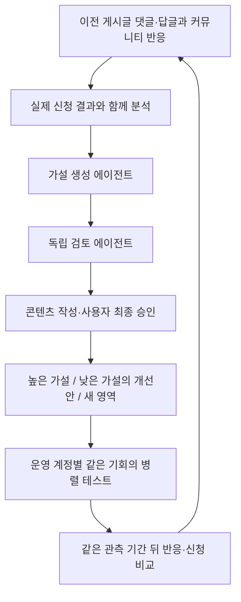

# Mu GTM Loop

### 사용자 반응으로 가설을 만들고, 높은·낮은·새 가설을 병렬로 검증하는 GTM 루프

**Clone Loop Day 제출 저장소 · 2026-10-24**

Mu는 카카오톡으로 부탁하면 모바일 앱을 직접 조작하는 개인 비서다. 현재 사전 사용 신청 단계이며, 이 프로젝트는 **어떤 고객·앱 작업·메시지가 실제 신청으로 이어지는지 학습하는 루프**를 설계하고 구현한다.

> **제출 시점:** 판단 코어·역할별 평가 기준·실행 기록을 구현했고 44개 테스트와 가상 7일 시나리오를 통과했다. 실제 모델·게시·댓글 수집·신청 집계 연결은 아직 미완료이며, 실제 고객 성과는 미측정이다.

## 목표와 첫 고객

**집중 지표: 7일 동안 이번 캠페인에 귀속되는 중복 없는 신규 사전 신청자 수.**

첫 가설은 인기 식당을 예약하기 위해 앱에서 날짜·시간·인원을 반복 확인하는 사람이다.

> “이번 토요일 저녁, 두 명 예약 가능한지 확인해줘.”

직접 앱을 확인하는 수고를 채팅 요청으로 맡기는 가치를 시험한다. 음식 예약을 시작점으로 배송 조회·장바구니·메일 요약 등 다른 앱 작업으로 확장한다. 예약 성공·좌석 선점·즉시 이용을 약속하지 않는다.

## 루프 구조



1. **수집:** 과거 게시물 전체의 댓글·답글과 관련 커뮤니티의 경험·질문·반대 의견을 읽는다.
2. **가설·검토:** 반응에서 가설을 만들고 별도 검토자가 근거·반증 조건·신청 지표 연결을 확인한다.
3. **병렬 실험:** 처음에는 균등하게 시험한다. 이후 높은 쪽, 낮은 쪽 또는 개선안, 새 영역에 같은 게시 기회를 준다.
4. **재관측:** 같은 기간 뒤 실제 신청과 반응을 비교해 유지·개선·확장을 결정한다.

복잡한 확률 배분은 사용하지 않는다. 낮은 가설도 즉시 버리지 않는다. 계정을 교차 배치하고, 관측 대기·수집 실패·도달 부족을 낮은 수요로 단정하지 않는다. 실제 계정은 현재 Threads **@mu.agent** 하나이며, 다계정 동시 배포는 설계와 Mock으로만 검증했다.

## 에이전트의 판단 기준도 교체한다

| 역할 | Rubric의 핵심 질문 |
| --- | --- |
| 가설 생성 | 실제 반응 근거가 있는가? 검증·반증할 수 있는가? |
| 가설 검토 | 증거가 충분한가? 신청과 연결되는가? 비교 조건이 타당한가? |
| 콘텐츠 작성 | 가설을 유지하는가? 제품 주장이 근거에 맞고 신청 경로가 명확한가? |
| 결과 검토 | 관측이 완료됐는가? 반대 근거·계정 차이를 고려했는가? |

[역할별 Rubric](config/rubrics/)은 JSON으로 분리하고 [설정](config/portfolio.json)에서 선택한다. 평가에 대상·기준 버전·해시·증거·이유를 남긴다. 가설 생성자는 자신의 최종 검토자가 될 수 없다. **Rubric 점수는 신청 성과를 대신하지 않는다.**

## 구현·검증 결과

| 항목 | 제출 시점 결과 |
| --- | --- |
| 로컬 판단 코어 | 가설·콘텐츠·계정별 배포·관측·다음 가설 연결 |
| 반응 처리 | 자기 게시물/커뮤니티 구분, 중복·누락·병목 처리 |
| 승인·측정 검사 | 정확한 콘텐츠·계정 승인, 관측 대기와 0 구분, 신청 중복 방지 |
| 테스트 | **44개 통과** |
| 포트폴리오 Mock | **3가설·3합성 계정 → 가상 7일 비교 → 개선안·확장 포함 5가설** |
| 실제 외부 운영 | 모델·수집·게시·수신함·스케줄러 미연결 |
| 실제 고객 성과 | 게시 미실행, 신규 귀속 신청 미측정 |

Mock은 병렬 배포 **계획과 합성 영수증**을 검증한다. 실제 병렬 네트워크 게시나 실제 에이전트의 판단 품질·고객 전환 증가를 검증한 결과는 아니다.

## 바로 재현하기

Python 3.10 이상, 표준 라이브러리만 사용한다. API 키나 외부 계정 없이 저장소 루트에서 실행한다.

```sh
# 전체 검증
python3 -m unittest discover -s tests -v

# 다가설·다계정·가상 7일 비교와 가설 확장
python3 scripts/mock_portfolio.py
```

결과는 `runs/mock/PORTFOLIO-*/report.md`와 `summary.json`, 일별 JSON에 저장된다. **출력의 신청 수는 합성 테스트 데이터이며 실제 트랙션이 아니다.**

저장된 증거: [포트폴리오 Mock 보고서](runs/mock/PORTFOLIO-20261024T082539-545f71/report.md) · [구조화된 결과](runs/mock/PORTFOLIO-20261024T082539-545f71/summary.json).

추가 재현: `python3 scripts/mock_loop.py`는 반응 기반 단일 루프, `python3 scripts/mock_refinement.py`는 게시 전 보조 콘텐츠 검토를 확인한다.

## 실제 7일 운영으로 이어갈 일

1. 실제 모델과 이전 게시물·커뮤니티 반응 수집을 연결한다.
2. 운영 계정의 게시 연결, 실제 신청 접수·배포별 귀속·기존/중복 제외를 검증한다.
3. 7일 시작·종료를 고정하고, 사용자가 최종 승인한 첫 게시를 실행한다.
4. 같은 관측 기간마다 높은·낮은·새 가설을 비교하고 실제 결과·증거를 누적한다.

캠페인 전체 신청만 알 수 있으면 가설별 승자를 선언하지 않는다. 게시마다 사용자 최종 검토가 필요하며 개인정보·인증정보는 Git에서 제외한다.

## 저장소 안내

| 경로 | 내용 |
| --- | --- |
| [PRESENTATION.md](PRESENTATION.md) | 상세 설명과 단계별 판단 기준 |
| [PLAN.md](PLAN.md) | 완료·남은 작업 |
| [src/portfolio.py](src/portfolio.py) | 가설 검토·병렬 슬롯·완료 관측 비교·확장 요청 |
| [src/feedback.py](src/feedback.py) | 사용자 반응 근거와 병목 판단 |
| [src/loop.py](src/loop.py) | 개별 실행·승인·영수증·집계 기록 |
| [config/](config/) · [prompts/](prompts/) | 설정·Rubric·역할별 실행 절차 |
| [docs/gtm/portfolio-loop.md](docs/gtm/portfolio-loop.md) | 병렬 비교의 상세 계약과 구현 한계 |
| [docs/ref/](docs/ref/) · [runs/](runs/) | 제품·행사·고객 조사 근거와 실행 증거 |
| [docs/plan/activity-log.md](docs/plan/activity-log.md) | 설계 변경·검증 이력 |
