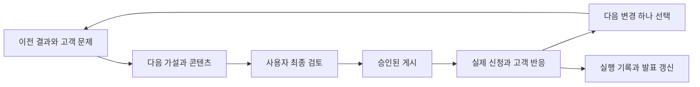

# Mu GTM 루프 발표

기준 시각: 2026-10-24T16:53:42.726062+09:00. 첫 채널은 Threads이며 현재는 출시 전 사전 사용 신청을 모집하는 단계다. 전략·루프 설계와 로컬 검증을 마쳤고 계정 생성은 사용자가 확인했다. 실제 게시·신청 성과 측정과 자동 스케줄 연결은 아직 시작하지 않았다.

## 어떤 제품인가

Mu는 카카오톡으로 부탁하면 모바일 앱을 직접 열고 조작하는 개인 비서다. 식당 예약 가능 여부 확인, 배송 조회, 장바구니 담기 같은 앱 작업을 채팅으로 맡기는 사용 방식을 준비하고 있다. 현재는 사전 신청 후 순차 연락하는 단계다. 결제·예약 확정 같은 중요한 작업은 사용자 승인 대상으로 소개한다.

제품의 범위는 다양한 앱 작업이지만, 첫 마케팅에서는 사람들이 바로 이해할 수 있는 인기 식당 예약 확인을 사용 사례로 선택했다. [제품 근거](../ref/product.md)

## 누구의 어떤 문제로 시작하는가

첫 고객 가설은 인기 식당을 예약하기 위해 모바일 앱에서 날짜·시간·인원 조건을 확인하는 사람이다. 전달하려는 가치는 앱을 직접 열고 조건을 입력하는 수고를 메신저 요청으로 줄이는 것이다.

대표 요청은 ‘이번 토요일 저녁, 두 명 예약 가능한지 확인해줘’다. 이 요청을 통해 관심을 만들고, 배송 조회·장바구니까지 가능한 범용 앱 자동화 비서 Mu를 설명한 뒤 사전 신청으로 연결한다. 예약 가능 여부 확인과 예약 성공·좌석 선점은 구분한다.

공개 후기에서는 반복적으로 앱에 들어가 날짜를 확인하는 행동을 관찰했다. 다만 이 수고를 비서에 맡기려는 의사와 실제 신청 의사는 아직 확인하지 못했다. 따라서 이것은 첫 실험의 가설이다. [고객 조사](../ref/customer-channel-research.md)

## 첫 채널과 전환 전략

첫 채널은 사용자가 선택한 Threads다. 기존 독자 없이 새 계정으로 시작해 제작자 관계와 사전 신청 상태를 밝힌 공개 게시물 하나로 시작한다. 예약 확인 사례 → 범용 Mu 소개 → 사전 신청의 흐름을 유지한다. 신규 계정의 자연 노출을 보장하지 않으며, 노출 부족과 제품 수요 부족을 구분한다.

사전 신청의 실제 목적지는 제품 지원 이메일이다. 기존 신청 버튼의 메일 제목에는 캠페인 코드가 자동 전달되지 않음을 확인했다. 제목 코드는 유입을 구분하기 위한 제안이며 현재 채택·실접수 검증 전이다. 코드 없는 일반 신청을 이번 홍보의 성과라고 단정하지 않는다. [신청 경로 증거](../ref/evidence/mu-cta-20261024.json)

## 반복 루프는 어떻게 동작하는가

목표 운영 방식은 최초 한 번 수동 시작한 뒤 하루 한 번 반복하는 것이다. 에이전트는 이전 기록을 읽고 고객 반응·신청을 관측하며 다음 콘텐츠와 학습을 준비한다. 새 게시물은 제목·본문·첨부물·링크·채널·계정을 사용자가 검토하고 승인한 뒤 공개한다. 승인 대기 중에도 관측·분석·기록은 계속한다.

연결할 외부 시스템은 Adapter로 분리했다. 조사, 승인, 게시 영수증, 신청 집계의 입출력을 파일 기반 코어가 기록하고 이전 실행과 연결한다. 구체 MCP 구현과 SchedulerAdapter·에이전트 런타임은 아직 미연결이다. 현재 코어는 실제 자동 조사·게시·수신함 집계까지 수행하는 완성된 운영 시스템은 아니다. [운영 계약](../plan/operation-loop.md)

## 무엇을 측정하는가

집중 지표는 **7일 동안 이번 캠페인에 귀속되는 중복 없는 신규 사전 신청자 수**다. 실제 수신이 확인된 신청에서 기존 신청자·중복·내부 테스트·스팸을 제외한다. 클릭·방문·메일 작성 화면 열기는 신청 완료가 아니다. 출처 불명 신청은 별도로 집계하고 캠페인 누적 스냅샷을 서로 더하지 않는다.

측정 시작·종료, 기존 신청자 기준, 실제 수신·귀속 방법을 첫 실행 전에 확정한다. 지금의 미측정 값을 신청 0명으로 표현하지 않는다. [측정 계약](measurement.md)

## 현재 실행 결과

| 항목 | 확인한 결과 |
| --- | --- |
| 공개 고객 원문 | 3건 검토; 반복 조회 행동 관찰, 위임 수요 미검증 |
| 채널 조사 | 3곳 검토 후 신규 배포 설계; 최종 첫 채널 Threads |
| 신청 경로 | 공개 페이지에서 이메일 신청으로 연결됨을 확인 |
| Threads 계정 | 사용자 생성 완료; 공개 프로필·로그인·게시 연결 확인 대기 |
| 콘텐츠 | Threads 본문·프로필·후속 질문 초안 준비 |
| 로컬 검증 | 경계 테스트 9개 통과; 새 실행을 이전 실행에 연결 |
| 실제 게시 | 미실행 |
| 신규 귀속 신청 | 미측정 |
| 자동 반복 | 요청 방식 설정 완료, 스케줄러·런타임 미연결 |

조사·초안·합성 테스트는 준비의 증거이며 고객 트랙션으로 집계하지 않는다. 실제 실행 기록과 계획 변경은 파일과 Git으로 보존한다. [최근 실행](../../runs/RUN-20261024T075232220733Z-587ee4.md) · [활동 이력](../plan/activity-log.md)

## 배운 점과 다음 실험

첫째, 인기 식당의 좌석 경쟁과 모바일 앱 확인의 수고는 다른 문제다. 앞으로 응답에서 어느 문제가 더 큰지 구분한다. 둘째, 신청 링크가 있다는 사실만으로 캠페인 귀속이 구현되지는 않는다. 셋째, 독자 0 조건에서는 메시지 반응을 판단하기 전에 실제 도달을 확인해야 한다.

다음 작업은 Threads 공개 프로필·게시 연결 확인, 신청 귀속·접수 확인, 반복 실행 연결, 최종 게시물 검토다. 실제 게시 후에는 노출 부족이면 도달 경로, 방문 부족이면 첫 문장, 신청 부족이면 신청 과정을 점검한다. 매번 주요 조건 하나를 바꾸고 표본이 부족하면 판단을 보류한다.

이 문서는 주요 결정·실행·측정 결과마다 갱신한다. 7일 결과가 생기면 같은 문서의 실제 성과·증거·학습을 업데이트한다.
