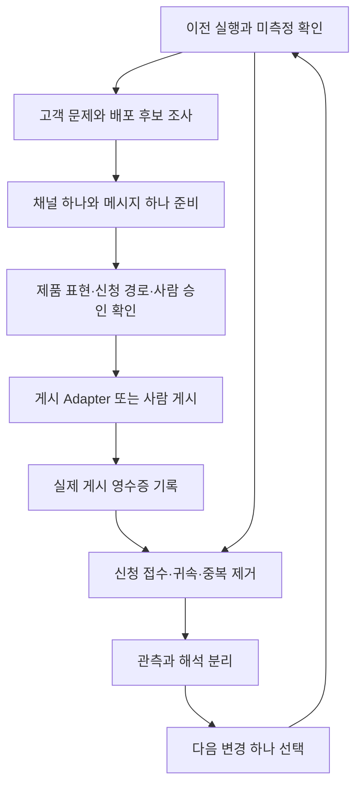

# 첫 GTM 루프 실행 설계

2026-10-24 / MU-KO-001 / EXP-MU-KO-001
상태: 설계 및 첫 공개 조사·로컬 실행 완료. 적격 고객·채널 추가 확인 대기, 실제 게시·측정 전. 구체 인프라는 Adapter로 연기한다.
전략: [ICP·GTM](../gtm/strategy.md). 메시지 원본: [첫 콘텐츠](../gtm/experiment.md).

## 첫 루프가 답할 질문

인기 식당 예약 가능 여부를 모바일 앱에서 확인하는 상황을 제시하면, 사람들이 범용 앱 자동화 비서 Mu의 사전 사용을 신청하는가?

성공 관측은 실제 귀속 신청이다. 1건도 관심 신호로 기록하되 성공 기준·시장 검증·인과 효과로 단정하지 않는다. 수상 목표나 성공할 신청 수는 현재 근거 없이 정하지 않는다.

## 흐름

측정은 신규 게시가 대기 중이어도 이전 게시에 대해 진행한다. 승인/연결이 없는 단계는 대기로 기록하고 독립적인 단계는 진행한다.

## 단계별 실행 계약

| 단계 | 입력과 에이전트 할 일 | 남길 결과 | 다음 단계 조건 |
| --- | --- | --- | --- |
| 0. 읽기 | 설정·제품 근거·이전 실행·직전 추천 읽기 | 이번 가설, 이전 추천을 적용/보류한 이유 | 첫 실행이면 이전 없음 명시 |
| 1. 고객·채널 | 공개 원문 최대 10개를 ICP 기준으로 판정; 채널 접근·참여 규칙 확인 | 원문 URL·시각·불편·적합성·선정 이유; 채널 후보 | 근거 있는 후보 1개 이상; 없으면 조사 조건 하나 재검토 |
| 2. 콘텐츠 | 합의한 메시지를 선택 채널 형식에 맞춤 | 정확한 본문, asset_id, CTA, 채널·계정 참조 | 모바일 앱 작업 가치·범용 비서 설명·사전 신청 상태가 명확 |
| 3. 검토 | 제품 지원 표현, 신청 접수 경로, 귀속, 기간, 기존 신청자 기준, 게시 승인을 확인 | 통과/대기와 이유; 본문 해시·계정·채널에 묶인 승인 | 모두 통과하면 실제 게시 가능 |
| 4. 배포 | 승인 범위 내 한 번 게시; 불확실하면 결과부터 조회 | posted/pending/failed/uncertain, 실제 URL·시각 | 실제 URL·시각 확인 시 posted; uncertain이면 재게시 금지 |
| 5. 성과 | 실제 접수 확인, 기간·캠페인 귀속·중복·기존·테스트·스팸 처리 | 캠페인 누적 스냅샷, 제외 집계, 정제된 증거 ID | 확인한 접수만 주 지표에 포함 |
| 6. 학습 | 관측·해석·미측정을 분리하고 병목 확인 | 다음 변경 하나, 근거, 다음 실행 제안 | 에이전트가 다음 실행에서 변경 적용 여부를 기록 |

## 첫 배포 선택 규칙

후보는 예약 관련 공개 대화, 식당/맛집/모임 커뮤니티처럼 고객 문제가 관찰되는 장소다. 구체 플랫폼을 조사하지 않았으므로 특정 커뮤니티의 활성도·홍보 허용 여부를 가정하지 않는다.

선택 순서: 문제 적합성 확인 → 실제 접근 가능 → 규칙상 참여/홍보 가능 → 예약 확인 상황과 시점이 관련됨. 통과 후보 중 맥락이 가장 직접적인 한 곳을 택하고 이유를 남긴다. 좋아요·팔로워 수만으로 선택하지 않는다. 없는 계정·독자를 전제하지 않는다.

허용 후보가 없으면 채널 조사를 계속하고 게시 대기를 기록한다. 계정 생성, DM, 이메일 발송, 운영자 문의, 유료 집행을 자동으로 대신 실행하지 않는다.

## 콘텐츠와 전환 경로

첫 콘텐츠는 [합의한 본문](../gtm/experiment.md)을 사용한다. 메시지 방향의 승인은 받았고, 실제 게시 대상·계정을 포함한 승인은 별도로 필요하다.

인기 식당 예약 확인 예시 → 범용 모바일 앱 자동화 비서 설명 → Mu 사전 신청 → 실제 접수.

한국어 Mu 페이지를 현재 목적지로 유지한다. 페이지가 메시지를 뒷받침하는지와 신청 링크가 작동하는지를 실제 연결 시 확인한다. 새 랜딩/폼 개발은 이번 설계에 추가하지 않는다. 수정 권한이 없거나 접수가 불명확하면 그 상태를 기록한다.

선택적 신청 이유 질문: ‘Mu에게 가장 먼저 맡기고 싶은 앱 작업은 무엇인가요?’ 회신을 강제하거나 실제 접수의 추가 조건으로 삼지 않는다. 답변은 예약 확인/기타 앱 작업/불명 같은 집계로 정제한다. 후속 메일을 보낼 권한은 현재 없다.

귀속은 campaign_id 보존을 우선하고 이메일 제목 코드·자기보고를 대안으로 둔다. asset_id까지 보존하지 못하면 캠페인 단위로만 보고한다. UTM 링크만으로 추적 완료라고 하지 않는다.

## 다음 실행에서 바꿀 것

- 미측정: 신청 수를 null로 유지하고 측정 연결 하나를 해결한다.
- 노출 부족: 같은 메시지로 배포 경로 하나를 점검한다.
- 노출 후 방문 부족: 채널·제안을 유지하고 첫 문장 하나를 바꾼다.
- 방문 후 신청 부족: 신청 경로를 먼저 점검하고 확인된 병목 하나를 고친다.
- 신청 발생: 어떤 앱 작업을 맡기려는지 확인 가능한 이유를 읽고 요청 예시 하나를 바꾼다.
- 고객이 예약 성공/자동 선점으로 오해: 문구 한 곳을 수정하고 요청 범위를 명확히 한다.

관측이 부족하면 가설을 기각하지 않는다. 100 노출/20 방문 설정은 잠정 운영값이며 실험의 유의성 기준이 아니다. 매일 무조건 변경하지 않으며 추가 관측도 유효한 결정이다.

첫 루프에서는 인기 식당 사례를 유지한다. 다른 앱 사례 확장은 초기 반응과 신청 이유를 검토한 뒤 별도 experiment_id로 진행한다. 누적 신청자는 전체 campaign_id에서 한 번만 센다.

## Adapter 책임과 구현 상태

| 경계 | 책임 | 현재 상태 |
| --- | --- | --- |
| ResearchAdapter | 원문·고객 판정·채널 근거 제공 | 기본 unconnected; JSON 입력 다리만 존재 |
| DraftAdapter | 이전 학습과 채널에 맞춘 문안 작성 | 에이전트가 config.draft 작성; 별도 모델 호출 미구현 |
| ApprovalAdapter | 정확한 문안·채널·계정에 대한 사람 승인 | 기본 unconnected; JSON 승인 기록 검사 가능 |
| PublishAdapter | 실제 게시와 영수증, 중복 요청 방지 | 외부 실행 미구현; JSON 영수증 입력만 가능 |
| MeasurementAdapter | 수신함 접수·기준·귀속·캠페인 중복 제거 | MCP 접근 가정; 실제 연결·중복 제거 미구현, 집계 계약 검사만 가능 |
| SchedulerAdapter | 다음 실행 예약·실행 확인 | 수동 제안만 존재; 예약 미연결 |

코어는 상태 기록·이전 실행 연결·집계 검사·다음 행동 추천을 맡는다. 자동 콘텐츠 개선이나 외부 도구 호출까지 구현됐다고 해석하지 않는다. 에이전트가 추천을 검토하고 다음 실행의 설정과 change_note에 반영해야 루프가 닫힌다.

## 지금부터의 순서

1. 이 설계와 합의 문안을 저장·재읽기하고 Git으로 기준점을 남긴다.
2. ResearchAdapter 입력으로 고객 원문·채널 후보를 채운다. 별도로 MeasurementAdapter 담당이 신청 접수 경로·기간·기존 기준을 확인한다.
3. 선택한 채널과 계정을 넣어 게시할 본문을 구체화한다.
4. 사람 승인과 측정 준비가 갖춰지면 첫 실제 게시를 진행한다.
5. 24시간 후 첫 성과 스냅샷을 확인하고 다음 변경 하나를 결정한다. 실행 시각·담당은 게시 시 확정한다.

일별 반복은 최대 7일 측정 종료까지 이어가며 최종 누적 스냅샷과 정제된 증거로 제출한다. 24시간은 운영 주기 제안이고 자동 스케줄 등록은 아니다.
